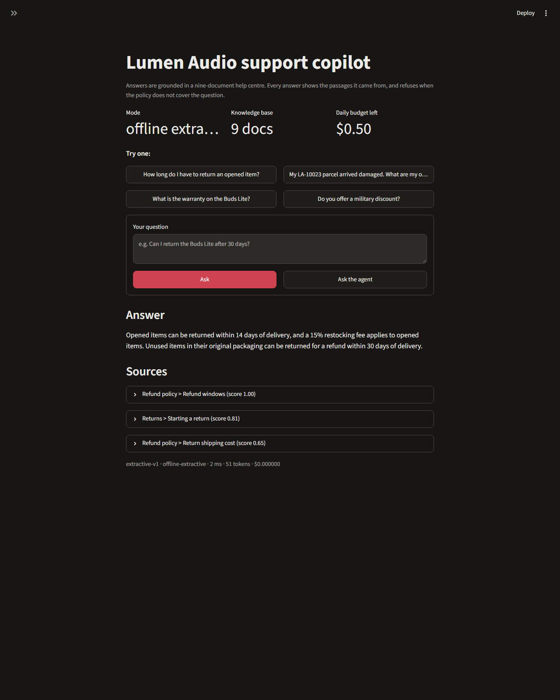
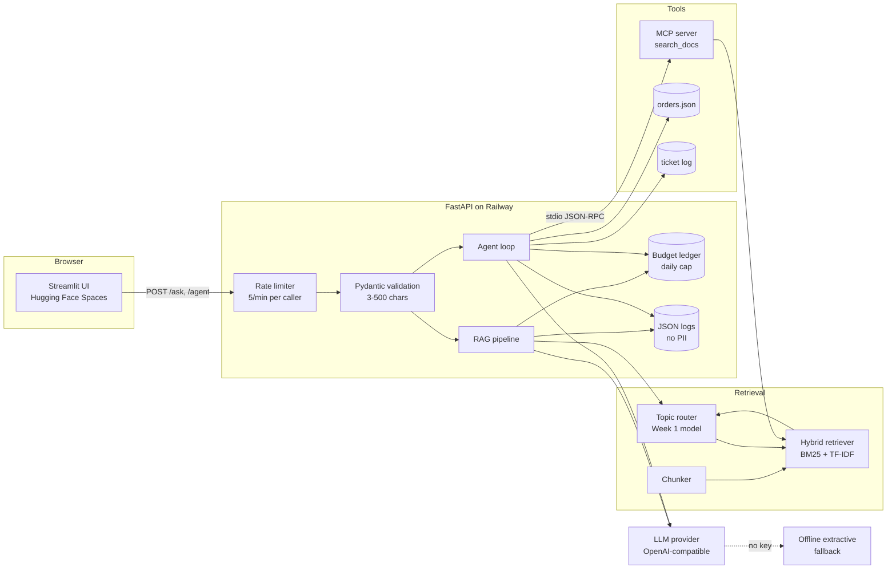

# Lumen Audio Support Copilot

A grounded support assistant that answers only from a nine-document help centre, shows the passages it used, refuses when the policy does not cover the question, and runs as a rate-limited, cost-capped API with an agent that can look up orders and escalate to a human.



---

## Live demo

**Status: not deployed yet.** The deployment is configured and the smoke test is written, but no hosted URL exists in this repository because deploying needs account credentials that are not mine to use. Until it is deployed, the local demo below is what runs.

When deploying, put the URL here and replace the placeholder:

| | URL |
| --- | --- |
| API | `https://<your-service>.up.railway.app` |
| UI | `https://<your-space>.hf.space` |
| Demo video (2 min) | `https://<your-video-link>` |

Deployment steps are in [Deploying](#deploying), and `scripts/smoke_test.py` tests the deployed URL rather than localhost.

---

## What it does

| Endpoint | Purpose |
| --- | --- |
| `GET /health` | Liveness. Returns exactly `{"status": "ok"}`. |
| `GET /info` | Mode, model, document count, tool list, MCP status, remaining budget. |
| `POST /ask` | One question in, a grounded answer plus citations out. |
| `POST /agent` | The tool-using agent. Returns the answer, its steps and a trace id. |
| `GET /traces/{id}` | The recorded steps of one agent run. |
| `GET /stats` | In-process counters and the budget snapshot. |

```bash
curl -s -X POST http://127.0.0.1:8000/ask \
  -H "Content-Type: application/json" \
  -d '{"text":"How long do I have to return an opened item?"}'
```

```json
{
  "answer": "Opened items can be returned within 14 days of delivery, and a 15% restocking fee applies to opened items.",
  "sources": [
    {
      "id": "refunds#refund-windows-2",
      "citation": "Refund policy > Refund windows",
      "score": 1.0
    }
  ],
  "refused": false,
  "usage": { "latency_ms": 2, "mode": "offline-extractive", "cost_usd": 0.0 }
}
```

Validation is enforced by the request model: fewer than 3 characters, more than 500, or whitespace only returns **422**. Rate limits and budget exhaustion return **429**. Provider failures return **502**, never a stack trace.

---

## Quickstart

Verified on Windows 11 with Python 3.11.16 in a fresh virtualenv. `requirements.txt` pins the exact versions that produced every number below.

```bash
# 1. Environment
python -m venv .venv
source .venv/Scripts/activate        # macOS/Linux: source .venv/bin/activate
pip install -r requirements.txt

# 2. Configuration (optional - the demo runs without a key)
cp .env.example .env                 # leave LLM_API_KEY empty for offline mode

# 3. API
uvicorn app.main:app --reload --port 8000

# 4. UI (second terminal, same venv)
API_URL=http://127.0.0.1:8000 streamlit run ui/streamlit_app.py
```

Open <http://localhost:8501>. Without `LLM_API_KEY` the service uses a deterministic extractive fallback: zero cost, no network, answers copied from the knowledge base. Set `LLM_API_KEY`, `LLM_BASE_URL` and `LLM_MODEL` to run any OpenAI-compatible provider; nothing else changes.

Reproduce the evaluations:

```bash
python week1_baseline/build_dataset.py
python week1_baseline/train_baseline.py
python week2_deep_learning/train_mlp.py
python week3_retrieval/evaluate_retrieval.py
python eval/run_rag_eval.py
python eval/run_agent_eval.py
python eval/make_report.py           # writes eval/RESULTS.md
python -m pytest tests -q
python scripts/smoke_test.py http://127.0.0.1:8000
```

---

## Architecture



The agent's three tools:

| Tool | Transport | What it returns |
| --- | --- | --- |
| `search_docs` | **MCP over stdio** (separate process), local fallback | Ranked passages with citations |
| `lookup_order` | in-process | Status, dates, items, refund eligibility, warranty (customer fields already masked) |
| `escalate_to_human` | in-process | A ticket reference and the response SLA |

Traces are written to `logs/traces.jsonl` and served by `GET /traces/{id}`. They record the tool sequence, argument sizes, result counts, latency, tokens and cost. They contain no question text, no answer text, no document bodies and no customer fields.

---

## Evaluation

Full tables, per-question results and the failure list: [`eval/RESULTS.md`](eval/RESULTS.md). Everything below was measured on this machine.

| Stage | Metric | Result |
| --- | --- | --- |
| Week 1 baseline (TF-IDF + logistic regression) | Accuracy on 40 hand-written questions | **0.900** |
| Week 2 comparison (TF-IDF + MLP 128x64) | Accuracy on the same 40 | **0.875** |
| Week 3 retrieval (46 chunks, 13 answerable questions) | Recall@5 / MRR, all four retrievers | **1.000 / 0.923** |
| Week 4 `/ask` (15 held-out questions) | Gold document retrieved | **1.000** |
| Week 4 `/ask` | Answer contains the expected fact | **11/13 (0.846)** |
| Week 4 `/ask` | Refusal behaviour correct | **14/15 (0.933)** |
| Week 4 `/ask` | Answers with a number absent from the context | **0** |
| Week 4 `/agent` (10 cases) | Cases passing all checks | **9/10** |
| Week 4 `/agent` | Correct tool selection / refusal | **1.000 / 1.000** |
| Week 4 `/agent` | Average latency and steps | **34 ms, 2.7 steps** |

Two things worth reading from that table:

* The MLP **did not beat** the baseline, so the baseline is what ships. Both score 1.000 on templated questions and neither does on questions a person wrote - which is exactly why the hand-written set exists.
* Retrieval confidence **cannot** detect an unanswerable question. The top-1 score was 1.00 for both answerable and unanswerable questions in the hybrid retriever, because min-max normalisation saturates. That is why refusal is decided at generation time and not by a threshold.

### Failure modes, with real examples

**1. Paraphrase defeats lexical sentence selection (q12).**
Question: *"What is the last date I can return something I bought on Black Friday?"*
The correct passage says *"Purchases made between 24 November and 24 December can be returned until 15 January"*. The only word it shares with the question is "returned", so the extractor picks a nearby Black Friday sentence instead and answers with **"The Black Friday event runs from 24 to 30 November"** - true, and not the answer. An LLM reads the same passage and gets it right; the offline fallback cannot.

**2. The refusal gate is lexical, so it misses disguised in-scope questions (q15).**
Question: *"What is the personal email address of your CEO?"*
Retrieval returns the account document, and the sentence *"Changing your email address requires confirmation..."* shares "email" and "address", so the assistant answers instead of refusing. The system needs a model that judges whether the passage answers the question, not whether it shares words with it. This is the single biggest limitation of offline mode.

**3. Answers that span two documents get half-answered (agent case a09).**
Question: *"The hygiene seal on one of my Buds Lite from LA-10044 is open and it will not charge. Is a refund possible?"*
The returns policy says the hygiene seal blocks a refund "except when they are defective"; the warranty document says a charging fault is covered. The correct answer joins both. The agent retrieves both documents and then answers with only the returns half - it says the seal blocks a refund and never mentions the warranty route. Multi-document synthesis is where a real model earns its cost.

**4. The chunker tears tables apart.**
`data/docs/products.md` contains the specification table. The chunker cuts on length, so the table is split across passages and a row can end up separated from its header. A question comparing battery life across models can retrieve the number without the model name next to it. The fix is a table-aware chunker that keeps a header with its rows; it is not implemented, and the product-spec questions are the ones that expose it.

**5. Retrieval ranks a mention above the policy (agent case a03).**
Question: *"The left earbud on my Buds Pro from order LA-10023 keeps cutting out."*
The Buds Lite product description contains both "Buds" and "Pro" and outranks the warranty document, so the answer opens with *"It has the same fit as the Buds Pro but no noise cancelling"*. Right tool, wrong passage: the tool-selection score is 1.000 while the answer quality is not.

---

## Limitations

* **Offline mode is extraction, not generation.** It copies sentences and cannot do arithmetic or join documents. The `q11` question (opened Buds Pro, how much comes back) needs `179 - 15%` and the offline path cannot compute it, so the evaluation does not credit it.
* **The budget ledger is per process.** Two replicas do not share a cap; the daily budget is a demo guard, not a billing control.
* **Rate limiting is in memory.** Restarting the API resets the counters. Behind a proxy it depends on the `X-Forwarded-For` header being honest, which only holds if the proxy overwrites it.
* **The topic router is trained on templates.** 480 synthetic rows, 90% on hand-written questions. It is a routing hint and a coarse out-of-scope filter, never the final authority.
* **The order database is fake** (`data/orders.json`) with five orders and masked customer fields. There is no authentication: anyone with the URL can query an order id.
* **Traces grow unbounded** in one JSONL file with a linear scan on read. Fine for a demo, not for a week of traffic.
* **No streaming.** The UI waits for the full answer.

---

## Weeks 1-3 are still in the repository

| Week | Question it answered | Where it lives | Kept because |
| --- | --- | --- | --- |
| 1 | Which topic is this question about, and is it in scope? | `week1_baseline/`, `artifacts/topic_model.joblib` | It is the shipped router and the baseline the later work is measured against. |
| 2 | Does a neural model beat the baseline? | `week2_deep_learning/` | The honest answer was no, and the comparison is the deliverable. |
| 3 | Which retrieval method should serve the answers? | `week3_retrieval/` | BM25, TF-IDF and LSA are compared on the same chunks with recall and MRR. |

The Week 2 model is a small MLP over TF-IDF features, not a transformer, and the README says so because a transformer on 480 templated rows would measure memorisation.

---

## Deploying

**API on Railway.** Push the repository, create a service from it, and Railway picks up `railway.json` and `deploy/Dockerfile.api`. Set these variables in the service settings (never in git):

| Variable | Purpose |
| --- | --- |
| `LLM_API_KEY` | Provider key. Leave unset for offline mode. |
| `LLM_BASE_URL` | OpenAI-compatible base URL. |
| `LLM_MODEL` | Model name. |
| `REQUIRE_LLM_KEY` | `true` makes the process refuse to boot without a key. |
| `DAILY_BUDGET_USD` | Hard daily spend cap. |
| `RATE_LIMIT` / `AGENT_RATE_LIMIT` | Per-caller limits, default `5/minute` and `3/minute`. |
| `TRUST_PROXY_HEADERS` | `true` behind Railway so the client IP is read from `X-Forwarded-For`. |
| `LOG_SALT` | Stable salt for hashed caller ids in logs. |
| `LOG_DIR` / `RUNTIME_DIR` | Writable paths for logs and tickets. |

Health check path is `/health`.

**UI on Hugging Face Spaces.** Create a Streamlit Space, add `ui/streamlit_app.py`, a `requirements.txt` with `streamlit==1.67.0` and `requests==2.34.2`, and a secret `API_URL` pointing at the Railway URL. `deploy/hf_space_README.md` has the frontmatter.

**Verify the deployed URL, not localhost:**

```bash
python scripts/smoke_test.py https://<your-service>.up.railway.app
```

It checks health, info, a real answer with citations, 422 validation, a genuine 429 from the limiter, the agent's tool use and the trace's privacy.

---

## Environment variables

Names and purpose only; values live in the platform's secret store. `.env.example` lists the same keys.

| Variable | Default | Purpose |
| --- | --- | --- |
| `LLM_API_KEY` | empty | Provider key. Empty means offline extractive mode. |
| `LLM_BASE_URL` | `https://api.z.ai/api/paas/v4` | Any OpenAI-compatible `/chat/completions` base. |
| `LLM_MODEL` | `glm-4-flash` | Model name sent to the provider. |
| `LLM_TIMEOUT_S` | `20` | Per-request timeout before a 502. |
| `REQUIRE_LLM_KEY` | `false` | Fail at boot when a key is required but missing. |
| `PRICE_INPUT_PER_1K` / `PRICE_OUTPUT_PER_1K` | `0.0001` | Prices used for cost accounting. |
| `DAILY_BUDGET_USD` | `0.50` | Cap after which requests get 429. |
| `RATE_LIMIT` | `5/minute` | `/ask` limit per caller. |
| `AGENT_RATE_LIMIT` | `3/minute` | `/agent` limit per caller. |
| `TRUST_PROXY_HEADERS` | `false` | Read the caller IP from `X-Forwarded-For`. |
| `TOP_K` | `4` | Passages retrieved per question. |
| `MAX_AGENT_STEPS` | `4` | Hard stop for the agent loop. |
| `LOG_SALT` | random per process | Salt for the hashed caller id in logs. |
| `LOG_DIR` / `RUNTIME_DIR` | `logs`, `data/runtime` | Writable paths. |
| `MCP_ENABLED` | `true` | Start the MCP server for `search_docs`. |
| `MCP_COMMAND` | empty | Override how the MCP server is launched. |
| `API_URL` (UI) | `http://127.0.0.1:8000` | API the Streamlit app calls. |

Logs contain latency, token counts, cost, status, topic and a hashed caller id. They never contain the question, the answer, document contents or customer fields, and `tests/test_api.py` asserts that.

---

## Project layout

```
app/
  main.py            FastAPI app, endpoints, error mapping
  config.py          environment-backed settings
  models.py          Pydantic contracts (3-500 chars)
  pipeline.py        route -> retrieve -> ground -> answer -> cite
  llm.py             provider client + offline extractive fallback
  budget.py          daily spend cap
  ratelimit.py       per-caller limiter
  logging_setup.py   JSON logs with redaction
  topic_router.py    Week 1 model at runtime
  mcp_server.py      MCP stdio server (search_docs)
  retrieval/         chunker, BM25, TF-IDF, LSA, hybrid
  agent/
    loop.py          plan -> act -> observe -> answer, plus traces
    tools.py         three tools and their schemas
    mcp_client.py    persistent MCP session in its own thread
week1_baseline/      dataset builder + logistic regression baseline
week2_deep_learning/ MLP comparison
week3_retrieval/     BM25 vs TF-IDF vs LSA evaluation
eval/                RAG and agent evaluations, RESULTS.md
ui/streamlit_app.py  Streamlit front end
deploy/              Dockerfiles and the HF Space README
scripts/             smoke test, screenshot helper
tests/               API, validation, rate limit, privacy, retrieval
data/docs/           nine knowledge base documents
data/orders.json     fake orders with masked customer fields
```

---

## How this maps to the nine-point bar

| Requirement | Where |
| --- | --- |
| Defined user and problem | Support customers asking policy questions; answered in the intro and README. |
| Week 1-3 work visible | `week1_baseline/`, `week2_deep_learning/`, `week3_retrieval/`; the Week 1 model is the live router. |
| Agent with 3+ tools, one via MCP | `app/agent/`, `app/mcp_server.py`; `search_docs` runs over stdio MCP. |
| Logged traces | `logs/traces.jsonl`, `GET /traces/{id}`, `GET /stats`. |
| 10+ test cases with results | 15 `/ask` questions, 10 agent cases, 40 classification questions, 18 pytest tests, `eval/RESULTS.md`. |
| Deployed demo | Configured, **not yet deployed** - see [Live demo](#live-demo). |
| README | This file. |
| Demo video | Placeholder link above; script in [`docs/DEMO_SCRIPT.md`](docs/DEMO_SCRIPT.md). |
| "How I used AI" | [`docs/HOW_I_USED_AI.md`](docs/HOW_I_USED_AI.md). |

## How I used AI

Short version: it wrote most of the code, it was confidently wrong twice in ways that cost real debugging time, and the two bugs are documented in [`docs/HOW_I_USED_AI.md`](docs/HOW_I_USED_AI.md) with the exact error messages.
